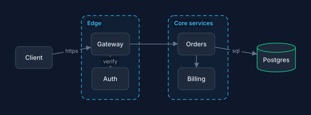

# bgraph

**A diagram DSL with explicit layout and a style cascade.**

bgraph turns `.bd` text files into diagrams. Declare elements and connections,
position them with relative anchors and layout constraints, and apply reusable
styles. For data-driven charts, provide values and let the diagram type calculate
the geometry.



[User guide](docs/guide/index.md) · [Examples](examples/) ·
[Language reference](docs/reference.md) ·
[Releases](https://github.com/Bunchyearth23/bgraph/releases)

## Features

- **Declared layout:** relative placement, rows, columns, alignment, shared
  sizes and nested groups for architecture, process and modeling diagrams.
- **A style cascade:** themes, inherited classes and inline overrides, with
  shared stylesheets and titled legends containing descriptive entries.
- **30 diagram types:** 29 specialised genres, plus `free`, covering software
  architecture, UML and BPMN, sequence diagrams, statistical charts, timelines,
  hierarchies, packets and infrastructure.
- **Export and preview:** SVG, PDF and JSON in the default build; optional PNG;
  a local browser preview that reloads when source files change.
- **Editor tooling:** diagnostics, completion, hover and navigation through
  `bgraph-lsp`, with extensions for VS Code and Zed.
- **Reusable sources:** includes, components, templates and CSV data, plus a
  Rust library, browser WebAssembly build and Typst integration.

See the [diagram type guide](docs/guide/graphiques.md) and the
[gallery](examples/) for complete sources and their rendered output.

## Installation

For packaged builds, consult [GitHub Releases](https://github.com/Bunchyearth23/bgraph/releases)
and follow the [installation guide](docs/guide/installation.md) for your
platform. Keep `bgraph` and `bgraph-lsp` available on your `PATH`.

To install from a source checkout, use **Rust 1.88 or newer** and run from the
repository root:

```sh
cargo install --locked --path . --bins
bgraph --version
```

Add `--features png` to the install command if you need PNG output. The
installation guide also covers local builds and updating an existing install.

## Quick start

Save this complete example as `architecture.bd`:

```bgraph
type free

style service { fill: #dbeafe stroke: #2563eb 1.5 radius: 6 }
style storage extends service { fill: #d1fae5 stroke: #059669 shape: cylinder }

node browser "Browser"
node api "API" .service
node db "Database" .storage

layout {
  place browser at (0, 0)
  place api right-of browser gap 60
  place db below api gap 48
}

browser -> api "HTTPS"
api -> db "SQL" { router: ortho }

legend {
  title: "Components"
  entry "Application service" .service
  entry "Persistent storage" .storage
}
```

Check the source, export it, then open the live preview:

```sh
bgraph check architecture.bd
bgraph architecture.bd -o architecture.svg
bgraph architecture.bd -o architecture.pdf
bgraph watch architecture.bd --open --port 0
```

The preview updates when you save the source. Keep its terminal running and
press `Ctrl+C` to stop it. Exported files are updated by running the export
command again.

`layout` controls geometry separately from declarations. The named classes
style both the elements and their legend swatches; the legend is placed below
the drawing automatically. The [first diagram tutorial](docs/guide/demarrage.md)
explains the language step by step.

To start with another diagram type, run `bgraph init` to list the types in your
build, then `bgraph init pie -o chart.bd` to create a worked example.

## Editors and integrations

- **[VS Code and Zed](docs/guide/editeurs.md):** installation, language-server
  setup and preview shortcuts. VS Code renders unsaved text in a side pane;
  Zed opens a browser preview that updates on save.
- **[Other LSP editors](editors/README.md):** configurations for Neovim, Helix
  and Emacs.
- **[Rust](docs/API.md):** embed the renderer in an application, with optional
  features for diagram types and export formats.
- **[Browser playground](playground/README.md):** build and run the WebAssembly
  editor and preview locally.
- **[Typst](typst/README.md):** render diagrams while compiling a document or
  insert an exported SVG.

The browser renderer, VS Code preview and Typst plugin take self-contained
source. Use the CLI or browser watcher for includes and external data files.
See the [integration guide](docs/guide/integrations.md) for complete workflows.

## Documentation

| Topic | Guide |
|---|---|
| Positions and groups | [Layout](docs/guide/placement.md) |
| Classes, themes and legends | [Styles](docs/guide/styles.md) |
| Exports and command-line tools | [Commands](docs/guide/commandes.md) |
| Shared sources and data | [Composition](docs/guide/composition.md) |
| Syntax and properties | [Language manual](docs/language.md) · [Generated reference](docs/reference.md) |
| Common problems | [Troubleshooting](docs/guide/depannage.md) |

Run `./docs.sh` from a source checkout to serve the documentation locally with
navigation, search and the gallery. See the
[documentation setup guide](docs/guide/documentation.md) for prerequisites
and static-site builds.

## Development and support

From the repository root:

```sh
cargo build --locked --release
cargo test --locked
cargo clippy --all-targets
cargo fmt --check
```

The [runtime checks](tests/runtime/gate.sh) cover the CLI, language server,
WebAssembly and packaged integrations. When reporting a problem, include the
bgraph version, a minimal `.bd` source, the command or editor used, and the
expected and actual result.

Accepted contributions require a separate agreement granting the maintainer
the necessary rights, including commercial use. Consult [LICENSE](LICENSE)
before submitting a contribution or distributing a modified build.

## License

bgraph is source-available under the
[Non-Commercial Source License — Version 0.1 (Project)](LICENSE), held by
**Bunchyearth23**. Its terms permit studying the source, noncommercial building
and running, and private or internal noncommercial modifications.
Redistribution of sources or binaries
(modified or unmodified), mirrors and commercial use require prior written
authorization, apart from the technical copies permitted by hosting-platform
terms as specified in the license.
